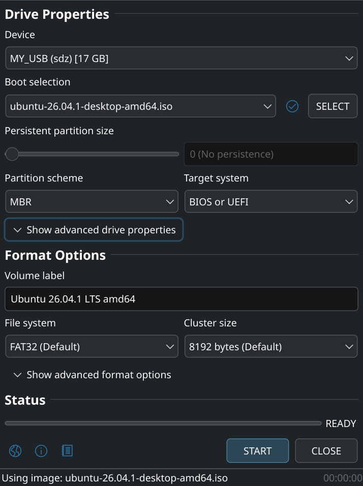

<p align="center">
  
</p>

<h1 align="center">Rufus for Linux</h1>

<p align="center">
  <b>The Reliable USB Formatting Utility</b>, ported to Linux, with a Qt 6 interface that runs natively under Wayland
</p>

<p align="center">
  <a href="https://github.com/mikigal/rufus-linux/releases"></a>
  <a href="https://github.com/mikigal/rufus-linux/actions/workflows/linux.yml"></a>
  <a href="https://www.gnu.org/licenses/gpl-3.0.html"></a>
  <a href="https://github.com/pbatard/rufus"></a>
</p>

<p align="center">
  
</p>

> [!NOTE]
> This is an **unofficial** port of [Rufus](https://github.com/pbatard/rufus) by Pete Batard.
> It is not affiliated with or supported by the upstream project: please report its
> problems [here](https://github.com/mikigal/rufus-linux/issues), not upstream.

## Features

Everything that Rufus does on Windows, except what Linux has no tool for:

- **Bootable drives** from Windows and Linux ISOs, and from disk images: raw, compressed
  (gzip, xz, bzip2, zstd, lzma, zip), VHD and VHDX
- **BIOS and UEFI**, with MBR or GPT, and [UEFI:NTFS](https://github.com/pbatard/uefi-ntfs)
  for the Windows images whose files do not fit in FAT32
- **Windows 11 for any PC**: no TPM, Secure Boot or RAM requirement, a local account, no
  data collection, the regional settings of this computer
- **Download Windows 10 and 11** ISOs from Microsoft, as [Fido](https://github.com/pbatard/Fido)
  does, and [UEFI Shell](https://github.com/pbatard/UEFI-Shell) ISOs
- **Persistent partitions** for Ubuntu, Debian and other live Linux images
- **FreeDOS and MS-DOS** boot drives
- **Format** in FAT, FAT32 (including large drives), NTFS, exFAT, UDF, ext2 and ext3
- **Bad blocks check**, which detects fake flash drives
- **MD5, SHA-1, SHA-256 and SHA-512** of images
- **Save** a drive to a VHD, VHDX or ISO image, and an optical disc to an ISO image
- **Secure Boot checks** of the boot loaders of the media (revoked by DBX or SBAT)
- **38 languages**, right-to-left included, a dark mode, and the cheat codes of Rufus
- **`rufus-cli`**, a command line interface with the same rules as the window

Not available on Linux: Windows To Go, ReFS, FFU images and the check of NTFS drives after
writing. There is no update check either: the packages of your distribution update Rufus.

## Installation

The [releases](https://github.com/mikigal/rufus-linux/releases) have packages for each of
these distributions, and two that run on any other one.

| Distribution | Package | Install with |
|---|---|---|
| Arch Linux, CachyOS, Manjaro | AUR: [`rufus`](https://aur.archlinux.org/packages/rufus) (built from source) or [`rufus-bin`](https://aur.archlinux.org/packages/rufus-bin) | `yay -S rufus` or `paru -S rufus` |
| Debian 13 | `rufus_*~debian13_amd64.deb` | `sudo apt install ./rufus_*~debian13_amd64.deb` |
| Ubuntu 26.04 | `rufus_*~ubuntu26.04_amd64.deb` | `sudo apt install ./rufus_*~ubuntu26.04_amd64.deb` |
| Fedora | `rufus-*.fc*.x86_64.rpm` | `sudo dnf install ./rufus-*.fc*.x86_64.rpm` |
| openSUSE Tumbleweed | `rufus-*.tw.x86_64.rpm` | `sudo zypper install --allow-unsigned-rpm ./rufus-*.tw.x86_64.rpm` |
| Any other | `rufus-*-x86_64.AppImage` | `chmod +x rufus-*.AppImage`, then run it |
| Any other | `rufus-*-x86_64.tar.gz` | extract it, then run `AppRun` |

The AppImage and the archive bring their own Qt, so they do not get the style of your
desktop. `rufus-cli` is the AppImage started with `--cli`, or through a symbolic link
named `rufus-cli`.

Rufus needs `mkfs.fat` (dosfstools) and `mkntfs` (ntfs-3g or ntfsprogs), which the
packages depend on, and uses `mkfs.exfat` (exfatprogs), `mkudffs` (udftools) and
`xorriso` when they are installed.

## Usage

Start **Rufus** from the menu of your desktop, or open an ISO with it. Pick the drive and
the image, then press **START**: the defaults are the ones of Rufus on Windows.

The window runs as you. Writing to a drive needs root, so it goes through `rufus-helper`,
which polkit starts after asking for your password, once for the session, as the UAC
prompt does on Windows.

The same can be done from a terminal:

```sh
# The drives that Rufus can write to
rufus-cli list

# Write an ISO, with the options of the window for what is left out, and no questions
rufus-cli write /dev/sdb --image ubuntu-26.04.1-desktop-amd64.iso --yes

# Windows 11 for a computer without UEFI
rufus-cli write /dev/sdb --image Win11.iso --partition mbr --target bios

# Download a Windows ISO: each step lists its choices
rufus-cli download "Windows 11"
```

See `man rufus` and `man rufus-cli` for all the options.

## Building from source

You need CMake 3.25, a C17 and C++20 compiler, Qt 6.5 (Widgets and DBus), OpenSSL 3,
libcurl, libext2fs, libudev and, optionally, hivex.

<details>
<summary>The build dependencies of each distribution</summary>

```sh
# Arch Linux
sudo pacman -S --needed base-devel cmake ninja qt6-base qt6-wayland curl openssl hivex e2fsprogs

# Debian, Ubuntu
sudo apt install build-essential cmake ninja-build pkg-config qt6-base-dev libext2fs-dev \
    comerr-dev libssl-dev libcurl4-openssl-dev libhivex-dev libudev-dev

# Fedora
sudo dnf install gcc-c++ cmake ninja-build 'cmake(Qt6Widgets)' 'cmake(Qt6DBus)' \
    e2fsprogs-devel libcom_err-devel openssl-devel libcurl-devel hivex-devel systemd-devel
```

</details>

```sh
cmake -S . -B build -G Ninja -DCMAKE_BUILD_TYPE=Release -DCMAKE_INSTALL_PREFIX=/usr
cmake --build build
ctest --test-dir build
sudo cmake --install build
```

Install with the `/usr` prefix: polkit only reads its actions from there (elsewhere, the
password prompt is the generic one of `pkexec`). `-DRUFUS_BUILD_GUI=OFF` builds only
`rufus-cli`. [`packaging/`](packaging) has what builds the packages.

## Tests

Rufus for Linux is tested without a person in front of a screen, and without root on the
host:

- **Unit tests** (`ctest`), which check, among others, the rules of the main window
  against the original Windows code, on thousands of random sequences of clicks
- **GUI tests** (`ctest -L gui`), which drive the window through accessibility, under a
  headless KWin
- **End-to-end tests** (`ctest -L e2e`), which write to an emulated USB stick, as root in
  a virtual machine, and boot it under BIOS, UEFI and UEFI with Secure Boot
- **Real ISOs** (`ctest -L slow`): Ubuntu, Fedora, Debian, Arch Linux and Windows 11,
  written, then booted to their menu, their live system or Windows Setup

See [`tests/e2e`](tests/e2e) and [`tests/gui`](tests/gui), and
[LINUX_PORT.md](LINUX_PORT.md) for how Rufus was ported.

## Versions

The version of Rufus for Linux is the one of Rufus that it is based on, then the release
of the port: **4.16.1** is the first release based on Rufus 4.16, then 4.16.2, and 4.17.1
will be the first one based on Rufus 4.17.

## License and credits

Rufus is [free software](https://www.gnu.org/philosophy/free-sw.html), under the
[GNU General Public License version 3](LICENSE.txt) or later.

Rufus is written by [Pete Batard](https://github.com/pbatard) and its
[contributors](https://github.com/pbatard/rufus/graphs/contributors), and translated by
its many translators. This port keeps its code and its look, and only replaces what was
Windows. See [rufus.ie](https://rufus.ie) and the
[FAQ](https://github.com/pbatard/rufus/wiki/FAQ) of upstream Rufus for more about it.
